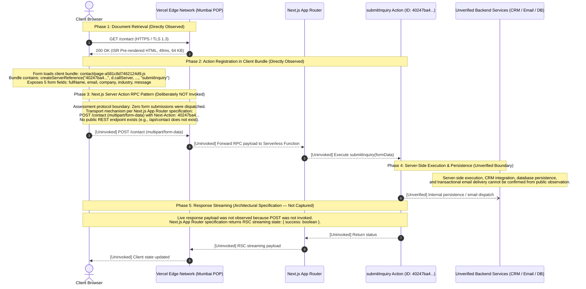
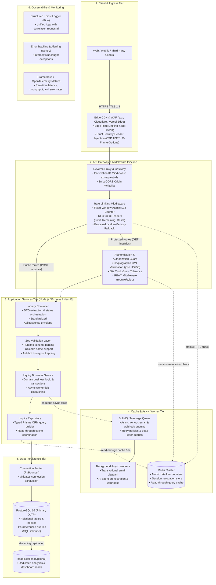
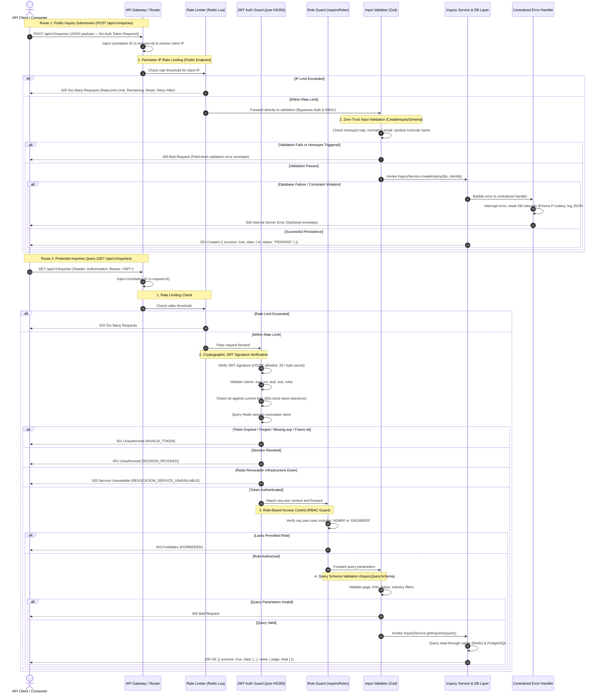

# Architecture & System Flow Diagrams

This directory contains visual models illustrating both the **empirically observed** architecture of `cynbit.in` and the **recommended decoupled backend architecture**.

---

## 1. Observed Request Flow (Next.js Server Actions)

> **Context:** Captures the client-to-server interaction on the `/contact` route identified through passive network inspection and client JavaScript bundle analysis. The Server Action reference was identified in the public bundle; form submission was deliberately **not invoked** during the audit to respect testing boundaries.

- **Source File:** [`observed-request-flow.mmd`](./observed-request-flow.mmd)

---

## 2. Recommended Backend Architecture (Decoupled Services)

> **Context:** A target architecture blueprint designed for scaling Cynbit's SaaS products, AI automation services, and API integrations. Organizes responsibilities into discrete tiers using the Controller-Service-Repository pattern.

- **Source File:** [`recommended-architecture.mmd`](./recommended-architecture.mmd)

---

## 3. Security & Validation Request Processing Flow

> **Context:** Step-by-step lifecycle of API requests aligned with [`recommendations/api-example.ts`](../recommendations/api-example.ts). Inquiry creation (`POST /api/v1/inquiries`) is public, rate-limited, and schema-validated; inquiry listing and retrieval (`GET /api/v1/inquiries`) require cryptographic JWT verification and RBAC authorization.

- **Source File:** [`security-request-flow.mmd`](./security-request-flow.mmd)

---

## 4. Standalone Interactive Visualizer

For an interactive browser experience with dynamic zoom, panning, dark/light theme switching, and tab navigation, open [`index.html`](./index.html) in any modern browser.
