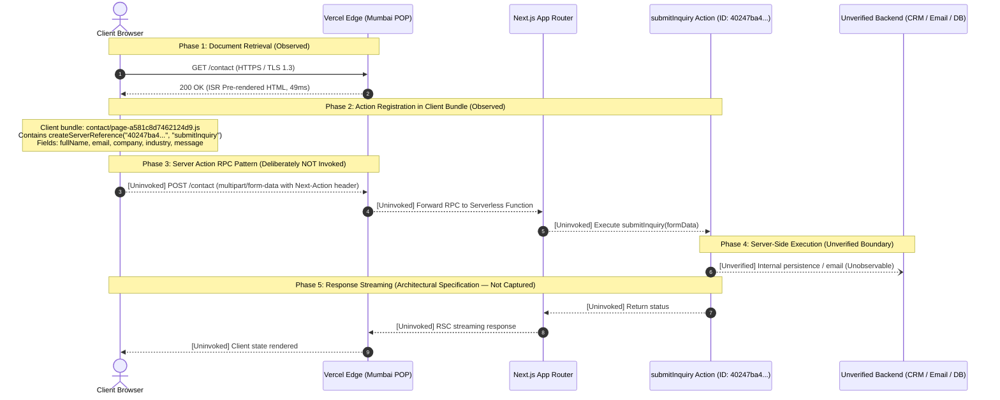

# 02 — Architecture Analysis

**Audit Target:** [https://www.cynbit.in/](https://www.cynbit.in/)  
**Classification:** Observed Infrastructure Analysis  

---

## 1. Observed Application Architecture

Passive inspection confirms that Cynbit's primary public web application is built on **Next.js App Router (React 18/19 Server Components)** hosted on **Vercel's global edge network**.


*(Interactive visual version with zoom/pan available at [`diagrams/index.html`](../diagrams/index.html) and source at [`diagrams/observed-request-flow.mmd`](../diagrams/observed-request-flow.mmd)).*

### 1.1 Edge Routing & Point-of-Presence (Observed)
- **Host Edge:** Requests return headers `Server: Vercel`, `X-Vercel-Id: bom1::...`, confirming termination at Vercel's edge node in Mumbai, India.
- **Prerender Caching:** Static and marketing pages return `X-Nextjs-Prerender: 1` and `X-Vercel-Cache: HIT`, yielding edge cache latencies under 60ms.
- **Dynamic Routes:** Server-Side Rendered routes (`/careers`, `/blog`, `/sitemap.xml`) return `X-Vercel-Cache: MISS` and `Cache-Control: private, no-cache, no-store`, requiring real-time compute at the origin.

---

## 2. Server Action RPC Mechanism (`submitInquiry`)

Unlike traditional web applications that post JSON payloads to RESTful endpoints (such as `/api/contact`), Cynbit uses Next.js internal React Server Action RPC.

### 2.1 Action Identification (Observed)
From client bundle `contact/page-a581c8d7462124d9.js`:
```javascript
let submitInquiryAction = (0, d.createServerReference)(
  "40247ba4465344b3386595bab4303317cdcce907df",
  d.callServer,
  void 0,
  d.findSourceMapURL,
  "submitInquiry"
);
```

### 2.2 Client-to-Server Protocol and Assessment Boundaries
- **Identification:** The action reference and 5 form fields (`fullName`, `email`, `company`, `industry`, `message`) were verified strictly by inspecting client JavaScript bundle code.
- **Form Submission Uninvoked:** In strict compliance with non-intrusive assessment boundaries, an actual `POST /contact` submission was **deliberately not invoked**.
- **Execution & Persistence Unverified:** Because no request was transmitted, serverless function invocation, internal database persistence, CRM synchronisation, and email dispatch could not be observed and are **explicitly unverified**.
- **Response Format:** Based on Next.js App Router architectural specifications, Server Actions return React Server Component streaming payload state (`{ success: boolean }`). No live response payload was captured during this audit.

### 2.3 Engineering Trade-offs
- **Pros:** Tight TypeScript integration across frontend and backend; rapid feature development without manually declaring schema contracts or REST routes.
- **Cons:** Direct coupling of frontend and backend runtimes; difficult to integrate with third-party consumers, external mobile clients, or microservices without exposing dedicated REST/gRPC endpoints.

---

## 3. Subdomain Isolation: `portal.cynbit.in` (Observed)

- Navigating to `/portal` yields an HTTP 307 temporary redirect to `https://portal.cynbit.in/`.
- In `robots.txt`, `/portal/`, `/admin/`, and `/api/` are explicitly disallowed.
- **Architectural Conclusion:** Administrative tooling, client dashboards, or authenticated SaaS products are isolated on a dedicated subdomain, preventing administrative code from leaking into the public marketing bundle.
