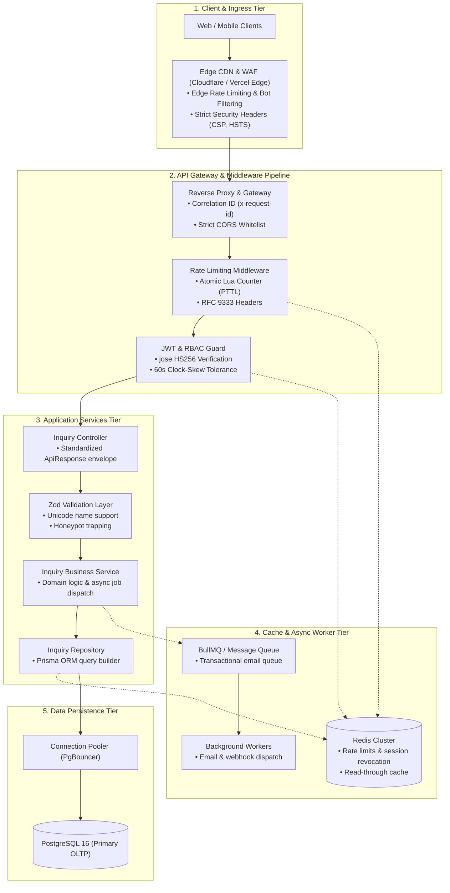

# 06 — Recommended Backend Architecture

**Document Type:** Target Architectural Blueprint  
**Purpose:** Recommended decoupled backend architecture for Cynbit Platform scaling.  
**Disclaimer:** *The patterns and technologies described here represent engineering recommendations for high throughput, maintainability, and security. They do not claim that Cynbit currently uses this exact infrastructure.*

---

## 1. Architectural Vision

As Cynbit scales its AI agent automation products (Cynbit Studio, Revio), SaaS offerings (TenantEase), and education programs (BitElevate), the backend architecture should transition toward a **decoupled service model**:

*(Interactive visual version with zoom/pan available at [`diagrams/index.html`](../diagrams/index.html) and source at [`diagrams/recommended-architecture.mmd`](../diagrams/recommended-architecture.mmd)).*

---

## 2. Core Architectural Subsystems

### 2.1 Controller-Service-Repository Pattern
- **Controllers (`inquiry.controller.ts`):** Handle HTTP transport, extract typed DTOs via Zod middleware, invoke domain services, and return standardized envelopes (`ApiResponse<T>`). Zero database queries.
- **Services (`inquiry.service.ts`):** Contain business logic, transaction boundaries, and background job dispatching. Transport-agnostic for isolated unit testing.
- **Repositories (`inquiry.repository.ts`):** Interface with PostgreSQL via Prisma ORM and manage Redis read-through caching and cache invalidation.

### 2.2 Redis-Backed Fixed-Window Rate Limiting
- **Atomic Lua Script:** Uses an atomic script to increment counters and fetch remaining millisecond TTL (`PTTL`) in a single round-trip, preventing race conditions under concurrent load.
- **Standard RFC Headers:** Emits `RateLimit-Limit`, `RateLimit-Remaining`, and `RateLimit-Reset` per RFC 9333; returns `Retry-After` on HTTP 429 per RFC 6585.
- **Adapter Layer:** Includes dedicated adapters for `ioredis` and `node-redis` (v4+), ensuring library-specific command parameters and return shapes are handled cleanly.
- **Fallback Policy:** If Redis is unreachable, falls back to a process-local in-memory store to maintain service availability. Operators are alerted via `X-RateLimit-Fallback: in-process`.

### 2.3 Timing-Safe JWT Authentication & RBAC Guard
- **Standard Library:** Uses `jose` with an explicit algorithm allow-list (`HS256` only), mitigating algorithm confusion attacks (`alg: none`).
- **Claim Enforcement:** Requires `sub`, `email`, `sid`, and `roles`.
- **Clock-Skew & Lifetime Rules:** Enforces a 60-second clock-skew tolerance on `iat` to reject future-issued tokens, requires `exp`, and caps maximum lifetime to 24 hours.
- **Cryptographic Key Strength:** Enforces minimum 256-bit (32-byte) key length for HS256 per RFC 7518 Section 3.2.
- **Infrastructure Fault Isolation:** Catches Redis revocation store failures distinctly, returning HTTP 503 `REVOCATION_SERVICE_UNAVAILABLE` rather than misreporting infrastructure errors as invalid user credentials.

### 2.4 Zero-Trust Input Validation & Sanitization (Zod)
- Strict runtime schema validation using `safeParseAsync`.
- Unicode property escapes (`\p{L}`) supporting international names (e.g. Müller, García, O'Brien).
- Anti-bot honeypot field (`website_trap`) silently discarding automated spam before touching databases.
- Strict numeric coercion for pagination parameters (`z.coerce.number().int()`).

### 2.5 Relational Data Persistence (PostgreSQL + Prisma)
- Managed PostgreSQL 16 with integrated connection pooling (PgBouncer) to prevent connection exhaustion.
- Primary keys using UUIDv4.
- Explicit cache invalidation (`DEL cynbit:inquiry:{id}`) on status updates to prevent serving stale read-through data.
